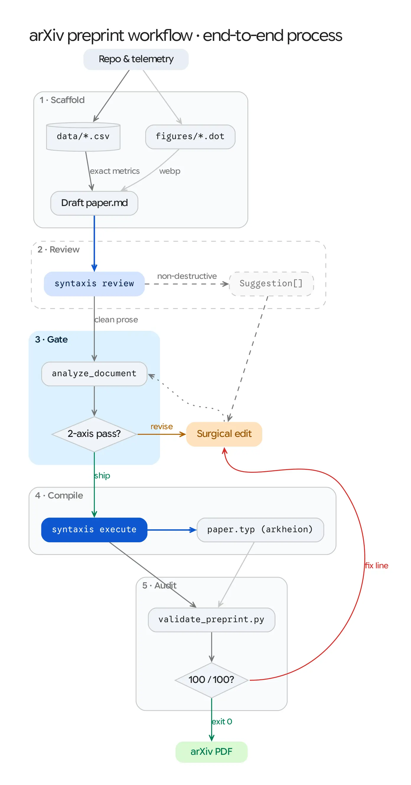
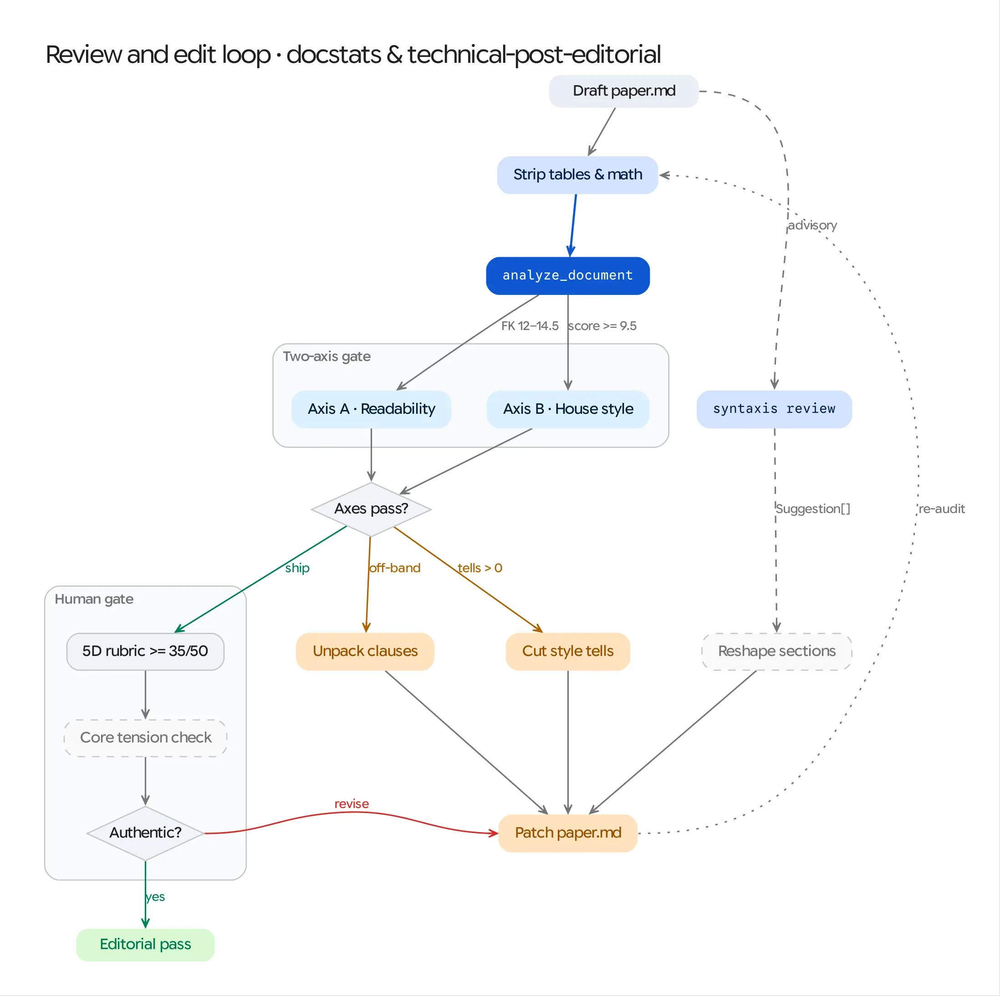
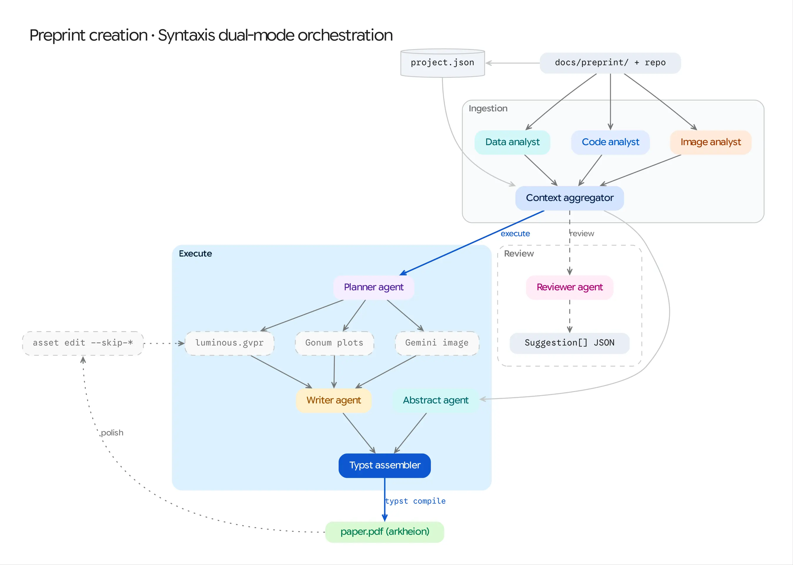
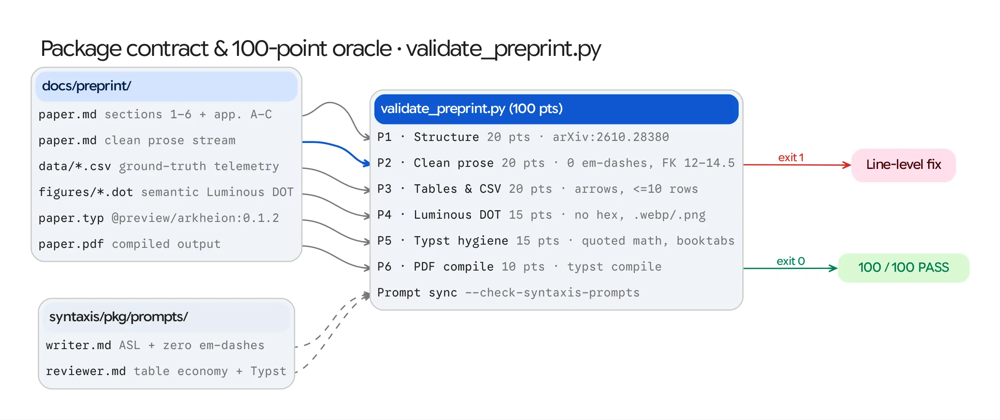

# arXiv Preprint Orchestration Workflow (`preprint-workflow`)

Coordinate the sibling skills in `repo-authoring` (`arxiv-preprint-authoring` and `technical-post-editorial`) alongside local checkouts of `syntaxis`, `docstats`, and `graphviz-style` to turn raw benchmark CSVs and repository code into a compiled, audited `@preview/arkheion:0.1.2` arXiv PDF.



---

## Resource, Asset & Script Files (Progressive Disclosure)

- [`scripts/run-preprint-gates.sh`](scripts/run-preprint-gates.sh): Single-command deterministic gate runner chaining Luminous `.dot` figure rendering, `docstats` clean-prose Axis A + Axis B scoring (with decimal-point protection and **per-section `max_sec_FK` hotspot detection**), optional `syntaxis review` JSON inspection, and the 100-point `validate_preprint.py` oracle (`--json` supported).
- [`references/howto-and-scorecard.md`](references/howto-and-scorecard.md): Practitioner preflight checklist, clean-prose Two-Axis calibration table, Typst visual/syntax traps, `revision-plan-vX.Y.md` & `editorial-scorecard.md` templates, and troubleshooting matrix.
- [`assets/01-preprint-lifecycle-light.webp`](assets/01-preprint-lifecycle-light.webp): Five-stage end-to-end preprint lifecycle diagram.
- [`assets/02-editorial-acceptance-gate-light.webp`](assets/02-editorial-acceptance-gate-light.webp): Clean-prose extraction, `docstats` Two-Axis gate, and `technical-post-editorial` human rubric loop.
- [`assets/03-syntaxis-orchestration-light.webp`](assets/03-syntaxis-orchestration-light.webp): Dual-mode `syntaxis` DAG (`review` vs. `execute`) and selective `--skip-*` asset regeneration.
- [`assets/04-preprint-oracle-matrix-light.webp`](assets/04-preprint-oracle-matrix-light.webp): `docs/preprint/` package contract mapped to the six pillars of `validate_preprint.py`.

---

## Sibling Skill & Tool Delegation

| Stage | Delegated Skill / Engine | Responsibility |
| :--- | :--- | :--- |
| **1. Scaffold & Blueprint** | `arxiv-preprint-authoring` ([docs](https://ghchinoy.github.io/agent-skills/plugins/repo-authoring/arxiv-preprint-authoring/)) | Scaffolds `docs/preprint/{data,figures}`, locks ground-truth CSVs first, enforces the `arXiv:2610.28380` 6-section progression and 10-row Table Economy rule. |
| **2. Semantic Figures** | `graphviz-style` (`luminous.gvpr`) | Renders semantic `.dot` files (`class="primary"`, `accent`, `store`, `code`; zero hex colors; aspect ratio `<= 3.0:1`) to `.webp` and `288 DPI` `.png`. |
| **3. Structural Peer Review** | `syntaxis review` + Editorial Reviewer | Emits non-destructive `Suggestion[]` JSON (`major`, `minor`, `info`) and versioned `revision-plan-vX.Y.md` checklists (`REV-vX.Y-NN`) without modifying source files. |
| **4. Two-Axis Prose Gate** | `docstats` + `technical-post-editorial` ([docs](https://ghchinoy.github.io/agent-skills/plugins/repo-authoring/technical-post-editorial/)) | Scores clean prose document-wide (`FK 12.0–14.5`, `ASL 15–19 w/s`) and per-section (`max_sec_FK <= 16.5`), enforces Axis B (`ai_tell_score >= 9.5`, zero prose em-dashes), and applies the 5D human rubric. |
| **5. Synthesis & Audit** | `syntaxis execute` + `arxiv-preprint-authoring` | Compiles `@preview/arkheion:0.1.2` Typst to `paper.pdf` (plus optional 4-page `@preview/reprobe:0.1.0` supplement), visually inspects PDF pages, and records `100/100 PASS` in `editorial-scorecard.md`. |

---

## Iterative Operating Model: Reviewer vs. Author Split (`revision-plan-vX.Y.md`)

Living research preprints evolve across multiple iterations (`v1.0` $\to$ `v1.7`) as new ablations, subsystem studies, and readability passes land. Separate the workflow into two distinct roles:

1. **Editorial & Scientific Reviewer Role (Read-Only / Plan Mode):**
   - Audits `paper.md`, `paper.typ`, compiled `paper.pdf` pages, `data/*.csv`, and upstream benchmark telemetry.
   - Runs `./scripts/run-preprint-gates.sh docs/preprint` to surface structural gaps, section-level `FK`/`ASL` hotspots, and Typst hygiene warnings.
   - Writes a versioned, tracked revision plan (`docs/preprint/revision-plan-vX.Y.md` with tracking ID `RP-YYYY-MM-DD-vX.Y` and discrete item IDs `REV-vX.Y-01..NN`, priority `P0/P1/P2`, target file/line ranges, and drop-in prose or table specs).
2. **Author & Typesetter Role (Execution Mode):**
   - Executes each `REV-vX.Y-NN` item across `paper.md`, `paper.typ`, `figures/*.dot`, and `data/*.csv` in lockstep.
   - Recompiles `paper.pdf` (and optional 4-page two-column supplement), marks `[x]` in `revision-plan-vX.Y.md`, and updates `docs/preprint/editorial-scorecard.md`.

---

## Execution Workflow

### Stage 1: Scaffold `docs/preprint/` & Render Luminous Figures

Activate `arxiv-preprint-authoring` before writing narrative prose:
1. **Lock Ground-Truth CSVs & Vernacular First:** Export canonical benchmark outputs to `docs/preprint/data/*.csv` and treat them as read-only ground truth. Align metric headers with standard arXiv/industry vernacular (e.g., `RTFx`, Pass 1 `TTFT` vs. Pass 2 `TTFS` / Response Latency, Pooled Corpus WER vs. Macro-Average Sample WER). If upstream CLI/JSON telemetry uses legacy field names, file a tracked `bd` issue in the code repository so code and paper stay synchronized.
2. **Author Multi-Row Luminous Figures:** Create `docs/preprint/figures/*.dot` using semantic `class` attributes only (no `#RRGGBB` hex colors or `fontname`). Wrap 6+ stage pipelines into a 2-row grid or dual-track cluster (`aspect_ratio <= 3.0:1`) so full-width figures never shrink to unreadable `< 0.8 in` strips in the PDF. Visually inspect both light and dark `.webp` renders after running `./scripts/run-preprint-gates.sh docs/preprint --render-figures`.
3. **Draft Along the Path of Discovery (Zero "Version Soup" or "Table Dungeons"):**
   - Follow the `arXiv:2610.28380` 6-section spine (`Abstract`, `1 Introduction`, `2 Related Work`, `3 Method`, `4 Experiments`, `5 Analysis`, `6 Conclusion`, `Limitations`, `References`, `Appendices A–B`).
   - **Problem $\to$ Intuition $\to$ Equation $\to$ Payoff:** Never introduce an architectural mechanism or equation in `§3 Method` before stating the physical failure mode that required it and giving a 1-sentence plain-English geometric or systems analogy.
   - **Timeless Mechanism Names in `§§1–6`:** Name table rows and configurations by architectural mechanism (e.g., `Beam + KT (120k, MRL-256 INT8)`), never by software release tags (`v0.2.0`, `v0.4.0`), sprint acts (`Act I/II`), or internal `bd` issue IDs (`v4o.1`). Quarantine software release history and companion engineering milestones to a **Release Lineage Crosswalk table in `Appendix B`**.
   - **No Table Dungeons:** Every subsection with a table must open with introductory context and close with analytical prose; place cross-engine summary leaderboards in `§4/§5` and move per-sample backtraces to `Appendix A`.

### Stage 2: Run Non-Destructive Structural Review (`syntaxis review`)

Register the manuscript, CSV directory, and codebase in Syntaxis so structural gaps surface before line editing:

```bash
SYNTAXIS=~/projects/syntaxis/bin/syntaxis

$SYNTAXIS project create my_paper
$SYNTAXIS project goal set my_paper arxiv @preview/arkheion:0.1.2
$SYNTAXIS project source add my_paper "$PWD/docs/preprint/paper.md"
$SYNTAXIS project source add my_paper "$PWD/docs/preprint/data"
$SYNTAXIS project source add my_paper "$PWD" --type code

$SYNTAXIS review my_paper --save
```

Resolve `major` structural, citation, and Table Economy suggestions in `paper.md` before running prose lints. When ingesting a new upstream code release, perform a **Future Work Graduation Pass**: promote newly solved items out of `## Limitations` into `§4/§5` or `Appendix B`, and update `## Limitations` with the next Amdahl bottleneck.

### Stage 3: Pass the Two-Axis & Per-Section Editorial Gate (`docstats` + `technical-post-editorial`)

Audit clean prose asynchronously after drafting, then activate `technical-post-editorial` to resolve both document-wide and section-level diagnostic flags. Consult [`references/howto-and-scorecard.md`](references/howto-and-scorecard.md) for exact thresholds.



1. Run the unified gate script (which strips Markdown tables, code blocks, math, and `## References`, and protects decimal numbers like `1.78%` from false sentence splits):
   ```bash
   ./scripts/run-preprint-gates.sh docs/preprint --project-id my_paper --json
   ```
2. **Eliminate Section-Level Readability Hotspots:** A passing overall `FK` (`12.0–14.5`) can still hide an `Impenetrable` `## Limitations` or `## Appendix B` section (`FK > 20`, `ASL > 35 w/s`). Apply `technical-post-editorial` surgical edits until:
   - Overall clean prose lands in **`FK 10.5–14.5`** (`ASL 15–19.5` w/s)
   - **Every individual section** satisfies **`max_sec_FK <= 16.5`** and **`ASL <= 24.0` w/s** (zero 45+ word multi-parenthetical sentences)
   - Axis B hits **`ai_tell_score >= 9.5 / 10.0`** (`0` prose em-dashes, `0` throat-clearing openers, `0` binary contrast frames, `-ly` adverb rate `<= 1.0/100w`).
3. Verify the five-dimension human rubric (`>= 35/50` across Directness, Rhythm, Density, Authenticity, and Trust) and Ruth Starkman's Core Tension test.

### Stage 4: Compile `@preview/arkheion:0.1.2` Typst & Visually Inspect `paper.pdf`

Synthesize visual assets and compile `paper.pdf` via the six-phase Syntaxis DAG, or sync and compile `docs/preprint/paper.typ` directly (alongside an optional 4-page two-column Extended Abstract using `@preview/reprobe:0.1.0`).



```bash
# Full 6-phase synthesis (Analysts -> Context -> Planner -> Luminous/Gonum/Image -> Writer -> Typst PDF)
~/projects/syntaxis/bin/syntaxis execute my_paper --verbose

# Fast visual iteration without re-running LLM analysis or prose writing
~/projects/syntaxis/bin/syntaxis project asset edit my_paper asset-12345 \
  --prompt="$(cat docs/preprint/figures/fig1_paradigms.dot)"
~/projects/syntaxis/bin/syntaxis execute my_paper --skip-analysis --skip-planning --skip-writing
```

**Mandatory Visual PDF Page Inspection:** `typst compile` exiting `0` does not guarantee visual layout quality. Always read the compiled `paper.pdf` page-by-page to verify:
- **Zero accidental bullet dots (`•`) in table cells:** Leading hyphens with a space (`[ - (0% Δ)]`) inside `#table(...)` cells trigger Typst's unordered list syntax; escape them as `[\- (0% Δ)]`.
- **No 50% blank half-pages:** Float large `#figure(kind: table, placement: auto, ...)` blocks so Typst backfills prose around page breaks.
- **Native appendix heading counters:** Reset appendix numbering with `#counter(heading).update(0)` and `#set heading(numbering: "A.1")` rather than hardcoding `=== A.1` (which renders as `7.1 A.1`).

### Stage 5: Close the Loop on the 100-Point Oracle & Persist `editorial-scorecard.md`

Run `./scripts/run-preprint-gates.sh` as the final pre-submission gate. Every pillar in `validate_preprint.py` (Structure, Clean Prose, Tables & CSVs, Luminous DOT, Typst Hygiene, and `typst compile`) must pass, and the resulting metrics and per-section clean-prose heatmap should be recorded in `docs/preprint/editorial-scorecard.md`.



```bash
./scripts/run-preprint-gates.sh docs/preprint --render-figures --json
```

Patch any reported line-level error or section hotspot and re-run until `"passed": true` and `"score": 100`.
